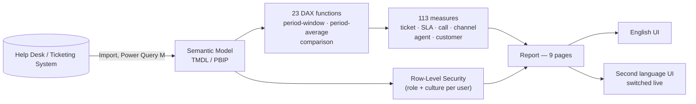

# Customer Support Analytics

A **Power BI** support-operations solution — ticket volume, service level, call
analytics, agent performance, and customer analytics for a helpdesk/support
organization, across 9 report pages.

This repository documents the architecture and DAX behind this solution. It's a
portfolio write-up, not the live report: all entity values are sample data — no real
customer, agent, or business figures are included here.

## Business context

Support leadership needed one bilingual view across every angle of the operation:
is service level holding against target, which channels and categories are driving
volume, how is each agent and team performing, and which customers need attention —
without cross-referencing separate exports for tickets, calls, and CSAT.

## What this covers

- **Ticket volume & status monitoring** — open/closed/in-progress/escalated/resolved,
  backlog, and priority breakdowns.
- **Service level & SLA tracking** — 15-minute first-response target, current vs.
  prior year/month, and performance against target.
- **Quality & escalation metrics** — escalation rate, reopened rate, resolution rate.
- **Call analytics** — calls per ticket, single- vs. multi-call resolution, high-
  effort case identification.
- **Channel performance** — Email/Phone/Chat/Social Media, each with the same metric
  set reused through one filtered `CALCULATE`, not four separate measure trees.
- **Agent & customer performance** — per-agent workload vs. target, top/bottom
  rankings by name, customer segment/region/tier breakdowns.
- **A fully dynamic, bilingual UI** — every title and label resolves live from a
  `Security → Labels → Dynamic Labels` chain; English is the default, with Albanian
  supported as a live, switchable culture.

## Architecture

## Tech stack

- **Power BI** — authored in [PBIP](https://learn.microsoft.com/power-bi/developer/projects/projects-overview) (TMDL) format for source control
- **DAX user-defined functions** — a 23-function reusable time-intelligence and comparison library (see [DAX Function Library](docs/dax-functions.md))
- **DAX measures** — 113 measures across 9 functional families, composed from that library (see [DAX Measure Catalog](docs/dax-measures.md))
- **Power Query (M)** — Excel-source import and shaping
- **Row-Level Security** — role- and culture-based, resolved from a single access-control table
- **Dynamic localization** — a live culture toggle driving every page and visual title in the report from one measure

## Documentation

| Doc | Contents |
|---|---|
| [Data Model](docs/data-model.md) | Star schema, ER diagram, table catalog, relationships, and RLS |
| [DAX Function Library](docs/dax-functions.md) | All 23 reusable functions — period-window, period-average/extreme, and comparison families — with full DAX bodies |
| [DAX Measure Catalog](docs/dax-measures.md) | Ticket, SLA, quality, call, channel, agent, and customer measures, built on the function library |
| [Dynamic Titles & Localization](docs/dynamic-titles.md) | The `Security` → `Labels` → `Dynamic Labels` chain in full: the `PageKey` band scheme, every label family worked through, the exact report-visual binding (verified against the actual PBIR JSON), and what changes to add a language |
| [Report Tour](docs/report-pages.md) | Page-by-page walkthrough of all 9 pages |

## Highlights worth a closer look

- **A function library, not copy-paste DAX.** 23 DAX user-defined functions —
  period-window (`YearToDay`, `PrevYear`, `PrevMonth`, `TwelMonth`, …),
  period-average (`AvgWeek`, `AvgMonth`, …), and comparison (`IndexDif`, `IndexQuot`,
  `Varianc`, …) — mean every KPI gets a full current/prior/CY/CM comparison family
  for free.
- **One filter, four channels.** Every channel metric (`Email …`, `Phone …`,
  `Chat …`, `Social …`) reuses the same base measure through a single `CALCULATE`
  filter rather than four independent measure trees — a change to the base measure
  propagates to every channel automatically.
- **Titles bind to measures, never hardcoded text.** Every page title is a hidden
  action-button visual with its title/subtitle bound via `fx` straight to a
  `'Page N | Title'` measure — verified directly against the report's own PBIR JSON,
  not just the measure definitions. A missing translation surfaces as a visible `⚠`
  instead of quietly falling back to English. Full write-up:
  [Dynamic Titles & Localization](docs/dynamic-titles.md).

## Related projects

Part of a set of Power BI solutions built on the same DAX time-intelligence library and dynamic-localization architecture:

- [Sales Performance Analytics](https://github.com/fuadgashi/Sales-Performance-Analytics)
- [Inventory Optimization and Replenishment Analytics](https://github.com/fuadgashi/Inventory-Optimization-and-Replenishment-Analytics)
- [Strategic Portfolio Analytics](https://github.com/fuadgashi/Strategic-Portfolio-Analytics)
- [Purchasing and Supplier Analytics](https://github.com/fuadgashi/Purchasing-and-Supplier-Analytics)

## License

[MIT](LICENSE) — this repository (documentation, DAX/architecture write-ups) may be
reused freely with attribution. It does not include the underlying `.pbix`/PBIP
project files, which remain private.

## Author

**Fuad Gashi** — Senior Power BI Consultant.
[GitHub](https://github.com/fuadgashi) · [Upwork](https://www.upwork.com/freelancers/~010e387a58063279a5) · [LinkedIn](https://www.linkedin.com/in/fuad-gashi-b81268110/)
