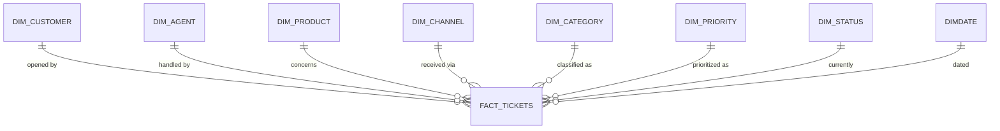

# Data Model

A single-fact star schema: one support-ticket fact table hung off seven dimensions,
plus the calendar and the security/localization infrastructure shared with every
model in this style. All entity values are sample data — no real customer, agent, or
business figures are included here.

## Entity-relationship diagram

## Table catalog

### Dimensions

| Table | Purpose |
|---|---|
| **dim_customer** | Customer master: name, email, segment, tier, region, country, signup date. Segment/tier/region back the Customer Analytics page's breakdowns. |
| **dim_agent** | Support agent master: name, team, seniority level, hire date. |
| **dim_product** | Product master: name, category, subcategory, unit price. |
| **dim_channel** | The four support channels — Email, Phone, Chat, Social Media. |
| **dim_category** | Ticket category + subcategory lookup — what kind of issue a ticket represents. |
| **dim_priority** | Priority lookup (e.g. Low/Medium/High/Urgent). |
| **dim_status** | Ticket status lookup (e.g. Open/In Progress/Resolved/Closed/Escalated). |
| **DimDate** | Standard calendar date table backing every time-intelligence measure. |

### Fact

| Table | Purpose |
|---|---|
| **fact_tickets** | **One row per support ticket.** Carries every dimension key, the date opened, first-response time (minutes), resolution time (hours), resolution date, CSAT score, reopened/escalated flags, and `number_of_calls` — the call-volume dimension of a ticket lives on the ticket record itself rather than in a separate calls fact, since a call is always tied to exactly one ticket in this business and never needs its own independent grain. |

### Infrastructure (security & localization)

| Table | Purpose |
|---|---|
| **Measure** | The analytical measure table — every KPI in the model lives here, none scattered across dimension/fact tables. |
| **Security** | Row-level-security table — one row per viewer, mapping a UPN to a **role** and a **culture**. Ships empty (no placeholder users) until real viewers are assigned ahead of delivery. |
| **Labels** | Plain data table — one row per page/visual, per culture, per label role. The source of every piece of user-facing text in the report. |
| **Dynamic Labels** | Measure-only table hosting one text measure per label, each a lookup against `Labels`. Full reference: [Dynamic Titles & Localization](dynamic-titles.md). |

## Relationships

All relationships are single-direction, many-to-one, and active.

| From | To |
|---|---|
| fact_tickets[customer_id] | dim_customer[customer_id] |
| fact_tickets[product_id] | dim_product[product_id] |
| fact_tickets[agent_id] | dim_agent[agent_id] |
| fact_tickets[channel_id] | dim_channel[channel_id] |
| fact_tickets[category_id] | dim_category[category_id] |
| fact_tickets[priority_id] | dim_priority[priority_id] |
| fact_tickets[status_id] | dim_status[status_id] |
| fact_tickets[date_key] | DimDate[Date] |

## Row-level security & dynamic localization

Three tables work together to drive a genuinely dynamic, bilingual UI — not two
duplicated sets of pages: `Security` resolves *who* is looking and which culture
they should see (`User Culture = SELECTEDVALUE(Security[Culture], "en-US")`);
`Labels` holds *what* every label says, in every supported culture, keyed by a
`PageKey` band scheme; `Dynamic Labels` holds *the lookup* — one measure per label,
bound into the report through hidden action-button visuals rather than text boxes.

The report ships with **English as the default culture** and **Albanian as a fully
supported secondary culture**. Assign a viewer's row a different `Culture` value and
every page and visual title relabels instantly; adding a third language means adding
rows to `Labels`, not touching a single measure or rebuilding the report.

Full reference — the key scheme, every label family worked through, the exact `fx`
binding, and what changes to add a language: [Dynamic Titles & Localization](dynamic-titles.md).
