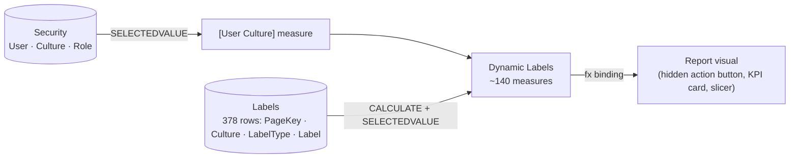

# Dynamic Titles & Localization

Every piece of user-facing text in this report — page titles, subtitles,
navigator tabs, KPI card headers, slicer captions — is a DAX measure lookup, not a
hardcoded string. This page is the full reference for that system: the three tables
behind it, the naming/key scheme, a worked example for every label family, and how a
label actually reaches the screen.

## Architecture



Three tables, three jobs:

| Table | Job |
|---|---|
| `Security` | Resolves *who* is looking and *which* culture they should see. Ships with zero rows — no placeholder users — until real viewers are assigned. |
| `Labels` | Holds *what* every label says, in every supported culture. 378 rows, plain data — no DAX. |
| `Dynamic Labels` | Holds *the lookup* — ~140 measures, each reading `Labels` filtered to its own key and the current culture. |

## The key scheme

`Labels[PageKey]` is a plain integer, but it's not arbitrary — it encodes both *which
page* and *which role* through numeric bands:

| Band | Role | Formula |
|---|---|---|
| 1–9 | Page title | `PageKey = N` |
| 201–209 | Page subtitle | `PageKey = 200 + N` |
| 401–409 | Page navigator-tab label | `PageKey = 400 + N` |
| 1200s | Visual title | one `PageKey` per visual, allocated in build order |
| 1400s | Visual subtitle | one `PageKey` per visual, allocated in build order |

*N* is the page number in report order (see [Report Tour](report-pages.md)):

| N | Page |
|---|---|
| 1 | Summary |
| 2 | Monthly Trends |
| 3 | Ticket Operations |
| 4 | Channel Analysis |
| 5 | Issue Analysis |
| 6 | Service Level & SLA |
| 7 | Call Analytics |
| 8 | Agent Performance |
| 9 | Customer Analytics |

## `Labels` — actual rows

A representative slice of the real table (English shown; every row below also has a
matching `sq-AL` row):

```
PageKey | PageName          | LabelType        | Label
--------|-------------------|------------------|--------------------------------------------
      1 | Summary           | Title            | Support Operations Overview
    201 | Summary           | Subtitle         | Key performance metrics
    401 | Summary           | Navigator Title  | Summary
      6 | ServiceLevelSLA   | Title            | Service Level & SLA Performance
    206 | ServiceLevelSLA   | Subtitle         | Overview of response times, channel service levels, and target achievements
    406 | ServiceLevelSLA   | Navigator Title  | Service Level
   1201 | KPISummary        | VisualTitle      | Key Performance Indicators
   1202 | TicketTrend       | VisualTitle      | Total Tickets Trend
   1203 | SLGauge           | VisualTitle      | Service Level
   1249 | SLvsTargetCard    | VisualTitle      | Service Level vs Target
   1449 | SLvsTargetCardSub | VisualSubtitle   | 15-minute response performance against the SLA target
   1289 | CustomersByTier   | VisualTitle      | Customers by Tier
```

A Power Query guard on the `Labels` partition errors the refresh on a duplicate
`PageKey + Culture + LabelType` combination — a copy-pasted row that wasn't re-keyed
fails loudly at refresh time, not silently at render time.

## `Dynamic Labels` — the lookup pattern

Every measure in this table follows the same three-line shape: resolve the culture,
then `CALCULATE` a `SELECTEDVALUE` against `Labels` filtered to this label's exact
key and that culture.

```dax
'Page 1 | Title' =
    VAR _culture = [User Culture]
    RETURN
        CALCULATE(
            SELECTEDVALUE(Labels[Label], "⚠"),
            Labels[LabelType] = "Title",
            Labels[PageKey] = 1,
            Labels[Culture] = _culture
        )

'Page 6 | Subtitle' =
    VAR _culture = [User Culture]
    RETURN
        CALCULATE(
            SELECTEDVALUE(Labels[Label], "⚠"),
            Labels[LabelType] = "Subtitle",
            Labels[PageKey] = 206,
            Labels[Culture] = _culture
        )

'KPI Summary | VisualTitle' =
    VAR _culture = [User Culture]
    RETURN
        CALCULATE(
            SELECTEDVALUE(Labels[Label], "⚠"),
            Labels[LabelType] = "VisualTitle",
            Labels[PageKey] = 1201,
            Labels[Culture] = _culture
        )
```

The `"⚠"` second argument to `SELECTEDVALUE` is the fallback when no row matches —
deliberately a visible warning glyph, not a quiet default to English. A missing
translation shows up as `⚠` on the page during review, instead of shipping a report
that silently reads wrong for one culture and looks fine for the other.

### The page-navigator exception

Each page's left-hand navigator tab needs its own label, but that label is *the same
text* as the page's own Navigator Title — so rather than adding a second `Labels`
row per page, `'PageNavN | Title'` re-reads the existing `400 + N` row directly:

```dax
'PageNav6 | Title' =
    VAR _culture = [User Culture]
    RETURN
        CALCULATE(
            SELECTEDVALUE(Labels[Label], "⚠"),
            Labels[LabelType] = "Navigator Title",
            Labels[PageKey] = 406,
            Labels[Culture] = _culture
        )
```

One `Labels` row, two consumers (`'Page 6 | Navigator Title'` and
`'PageNav6 | Title'`) — the nav bar and the in-page navigator always agree because
they're reading the same source row, never two copies that can drift apart.

## Binding a label to a visual

A measure existing isn't what makes a title dynamic — the visual has to actually be
bound to it. Every page title in this report is a **hidden action-button visual**:
icon, outline, text, and fill are all set to `show: false`, and only the
`visualContainerObjects.title`/`subTitle` properties are shown, each bound via `fx`
to the matching measure. Verified directly against the report's own PBIR JSON
(`pages/…/visuals/…/visual.json`):

```json
"visual": {
  "visualType": "actionButton",
  "objects": {
    "icon":    [{ "properties": { "show": { "expr": { "Literal": { "Value": "false" } } } } }],
    "outline": [{ "properties": { "show": { "expr": { "Literal": { "Value": "false" } } } } }],
    "text":    [{ "properties": { "show": { "expr": { "Literal": { "Value": "false" } } } } }],
    "fill":    [{ "properties": { "show": { "expr": { "Literal": { "Value": "false" } } } } }]
  },
  "visualContainerObjects": {
    "title": [{
      "properties": {
        "show": { "expr": { "Literal": { "Value": "true" } } },
        "text": {
          "expr": {
            "Measure": {
              "Expression": { "SourceRef": { "Entity": "Dynamic Labels" } },
              "Property": "Page 1 | Title"
            }
          }
        }
      }
    }],
    "general": [{ "properties": { "altText": { "expr": { "Literal": { "Value": "'Page header with title and subtitle'" } } } } }]
  }
}
```

Never a text box — a text box's content is a literal string with no `fx` option, so
a hardcoded title has no path back to `Labels` and quietly stops translating the
first time someone edits the page. Note the `altText` alongside the binding:
the same visual satisfies the accessibility requirement that every visual states
what it shows, in the same breath as the localization requirement.

## Adding a language

Because every label is a data row, not a code branch, supporting a third culture is
a data change, not a model change:

1. Add one `Security[Culture]` value for the pilot user(s).
2. Add one `Labels` row per existing label, in the new culture, same `PageKey` +
   `LabelType`.
3. Nothing in `Dynamic Labels` changes — every measure already filters on whatever
   `[User Culture]` resolves to.

No new measures, no new `SWITCH` branches, no touching the report canvas. The
`Labels` table is the entire surface area of a localization change.
